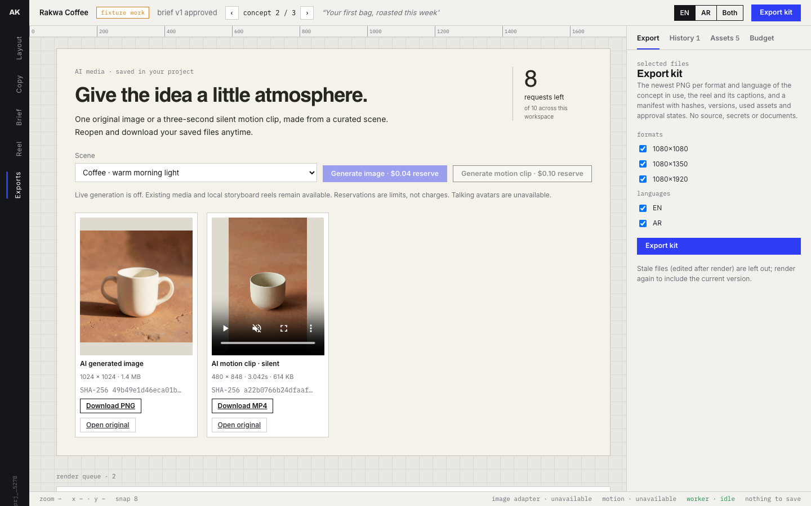

# Ad-Kit Workbench

**From a campaign brief to media you can use.**

Campaign production involves more than generating a picture. Ad-Kit Workbench connects the brief, bilingual copy, constrained layouts, media review and export.

Built by **Mohammed Abumtary** · TypeScript · React · PostgreSQL · generation worker · image and motion providers

[Demo guide](docs/DEMO.md) · [Engineering notes](docs/ENGINEERING.md) · [Verification & boundaries](docs/VERIFICATION.md) · [Recorded walkthrough](media/walkthrough.webm)

## The experience

Brief → copy → layout → generate media → review → export.

A local creative workflow with saved real image and short-motion outputs. New paid generation is disabled in the default launcher.

## Where the engineering matters

### Separate layout from media generation

Reviewable copy and layout checks remain useful without a provider. Real generated media is stored as a separate owned output.

### Treat an uncertain job as spent until reconciled

Durable reservations and dispatch state prevent cancellation from pretending to refund a video request that may already be running.

### Reopen results without regeneration

The saved PNG and MP4 remain available with paid calls disabled, including direct download and a stable paused video preview.

## Verified in the demonstration

- Real 1024-pixel image and approximately three-second vertical motion output recorded and persisted.
- Restart/reopen with paid calls disabled verified.
- 55 nonpaid checks passed: 15 unit, 22 database, seven renderer and 11 browser checks; builds passed.

## Explore the work

This repository is a presentation package: screenshots, walkthrough media and engineering notes. Application source, credentials and customer records are not included. The interactive demonstration runs in a separate local review environment; access can be arranged for a walkthrough.

[Read the guided demo](docs/DEMO.md) · [View my portfolio](https://mohammed-ab.github.io/)

## Scope

The video is generated short motion, not an avatar performance. Avatar generation is unavailable in this demo. It does not publish ads or spend a campaign budget.

Reviewed 10 November 2026. Results describe the recorded build and stated test scope.
